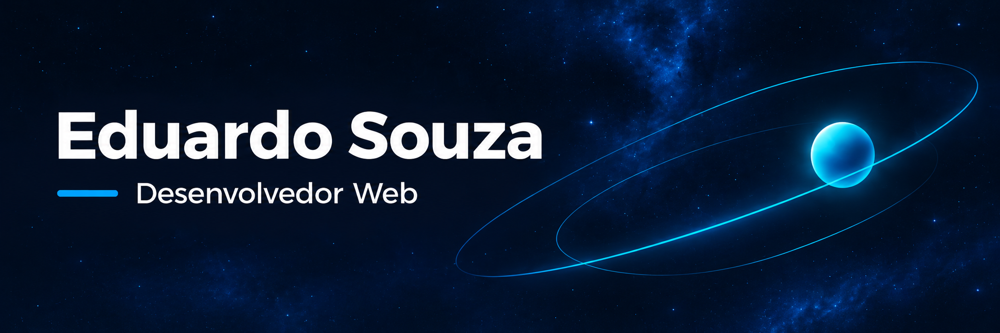

Crio aplicações e sites com **PHP e Laravel**, com interfaces em **HTML, CSS e JavaScript** e banco de dados **MySQL**.

---

### 🧩 Stack

  
  
  
  
  
  

---

### 📘 Estudando

Aprofundando meus estudos em **TypeScript** e **Java**, com foco em interfaces mais robustas, APIs e fundamentos.

  
  

---

### 🔗 Conecte-se

  
  
  

*Aberto a colaborações e freelas.*
